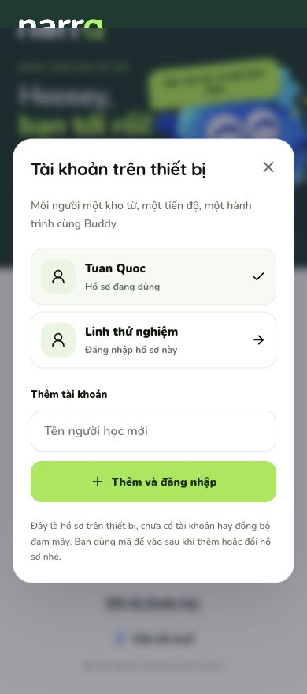
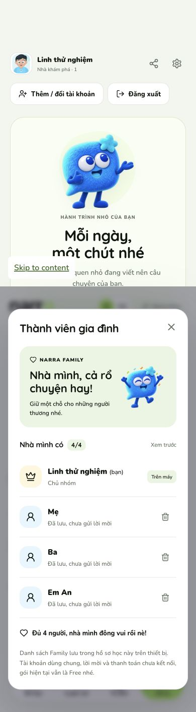
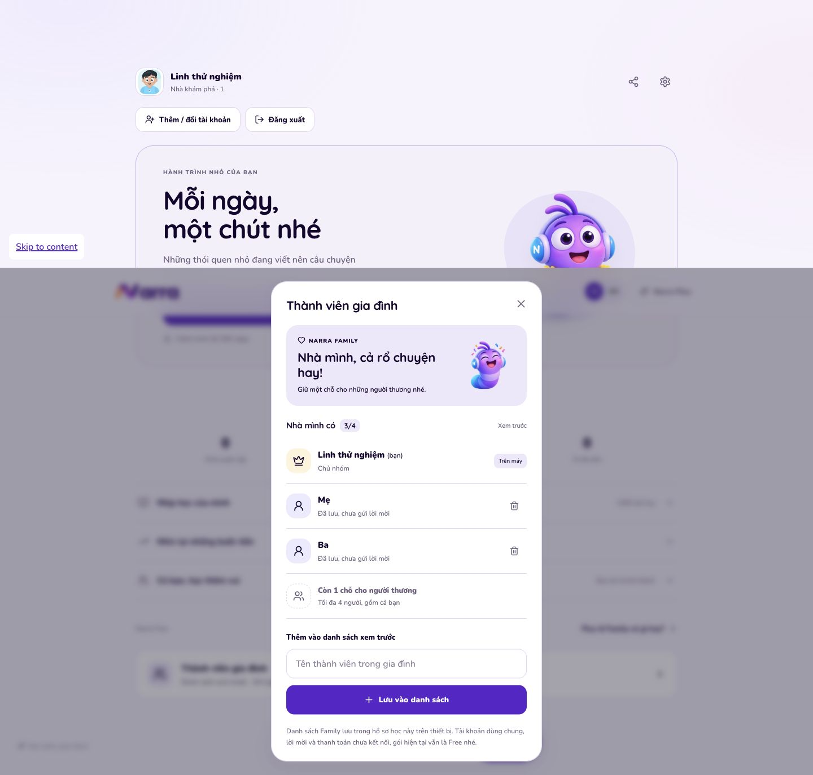

# Profile accounts and Family list, 16 November 2026

Profile offers Add / switch account and Sign out next to the learner identity. The account picker keeps up to six named profiles on this device and is also available from the entry screen after another profile is added. Adding or switching returns to code entry; logout ends access while keeping the selected profile's learning data.

The original profile retains its existing localStorage keys without moving or deleting records. Other profiles use their own storage suffix for preferences, statistics, words, player data, conversation drafts, word speaking counts, challenge passes, join nonces and result acknowledgements. A keyed provider boundary resets component state when changing learners. The active profile and entry session are tab scoped, and a code session for one profile cannot restore another profile. Catalog additions synchronize between tabs; shared codes remain preview access, never identity verification or private-data protection.

Family membership is a device preview. The list shows this profile as group owner, with three available places and no seeded people. Names can be saved or removed, with the owner counted toward the four-person capacity. Blank and duplicate names are rejected. Each saved name says that no invitation was sent. The list opens from the Family pricing card and directly from Profile after saving Family interest or a member. It neither activates a subscription nor connects the members' learning profiles.

## Verification

- TypeScript and Vite production build passed. The existing large-chunk advisory remains.
- `node --test tools/qa/accounts-family.test.mjs tools/qa/streaks.test.mjs tools/qa/challenges.test.mjs` passed all 23 tests. New tests cover storage separation, legacy keys and sessions, invalid catalogs, tab selection, profile-bound sessions, blocked storage, Family capacity and Vietnamese duplicate names. Challenge tests use mocked server storage.
- Browser verification used the production build at a separate local test origin. A new profile entered through NARRA123 with zero minutes, zero conversations and zero lessons. Switching to the original profile through TUANBO99 retained its seeded 11 minutes, one conversation and completed lesson. These baseline numbers are sample data, not newly measured practice.
- Direct Profile logout returned to entry. The entry account picker could select another profile. Reload kept the selected profile, its session and Family names. Switching away and back retained that profile's own Family list without exposing it in the original profile.
- Family duplicate feedback, four-person capacity, removal and return of the empty seat were exercised. Escape closed the nested Family dialog while keeping the pricing panel open; focus returned to its trigger.
- Account and Family dialogs had no horizontal overflow at 320, 768, 1024 or 1440 CSS pixels. Mobile screenshots use 390 pixels. Both mascot identities were visually checked; the final Option 5 page recorded no console errors.
- Apple/Email authentication, real Family invitations, cross-device membership, payments and physical-device assistive technology were not tested or added.

