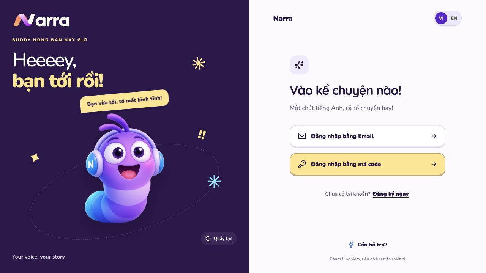
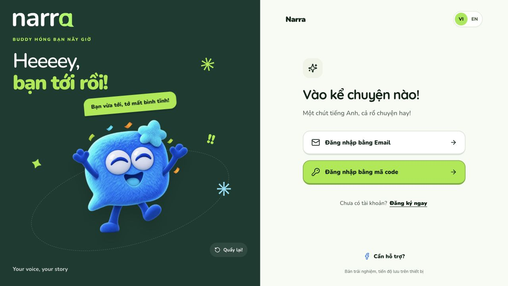

# Entry screen, 16 November 2026

The two brands share an entry screen, with their own logo, colors and mascot. Original Buddy hops across the welcome scene; Option 5 wriggles with no arms or legs. Motion runs once for 4.8 seconds, can be replayed, and respects reduced-motion preferences. The slogan remains `Your voice, your story`.

## Available in this preview

- `TUANBO99` and `NARRA123` open the experience, with surrounding whitespace and letter case normalized.
- Invalid codes keep the visitor on the form and show a friendly error.
- The preview visit uses sessionStorage, expires after 24 hours on the next load, and can continue in memory if storage is blocked.
- Settings has an exit action that removes preview access and retains local learning progress.
- Challenge deep links retain their URL while the visitor enters the preview.

These public preview codes and the client-side session are an entry UX, not user authentication or protection for private data. Account identity, access controls, cloud sync and multi-user storage remain separate backend work.

## Deliberately not connected

Apple ID is offered on iPhone/iPad, including iPadOS reporting MacIntel with touch. Email sign-in and registration have form screens, native input validation and an explicit unavailable message. They do not send mail, create accounts, save email/name, collect passwords, or grant access.

The Facebook support button opens help. Set `VITE_FACEBOOK_SUPPORT_URL` to a verified HTTPS Facebook page or m.me destination to enable the actual contact link. Until then, the screen says that the official channel is not connected; there is no invented Narra page.

## Verification

- Production build passed with TypeScript and Vite; existing bundle-size advisories remain.
- Helper checks covered both codes, invalid/partial codes, whitespace and case, Apple-mobile detection, and rejection of unsafe support URLs.
- Session checks covered valid reads, logout, expiry, malformed state, future timestamps and blocked storage.
- Browser walkthrough confirmed invalid-code feedback, TUANBO99 entry, settings exit, NARRA123 entry, unchanged local baseline progress, registration form disclosure, Facebook help, and both brand illustrations.
- Layouts at 320, 768, 1024 and 1440 CSS pixels had no horizontal overflow. The 1280x720 desktop layout was checked after reducing scene height.
- No console errors were recorded on the final Option 5 screen.
- Apple button visibility was unit checked, not tested on a physical iPhone/iPad. Real Apple/Email authentication cannot be tested until providers are configured.

