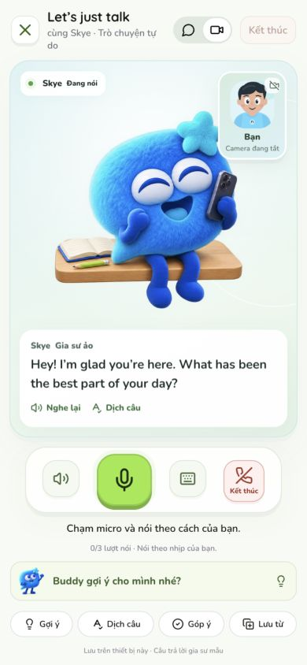
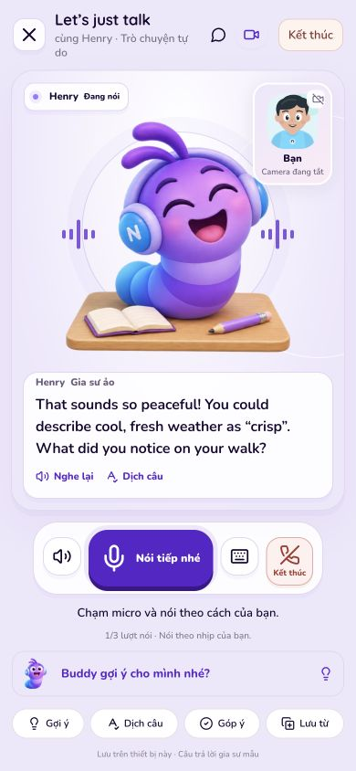
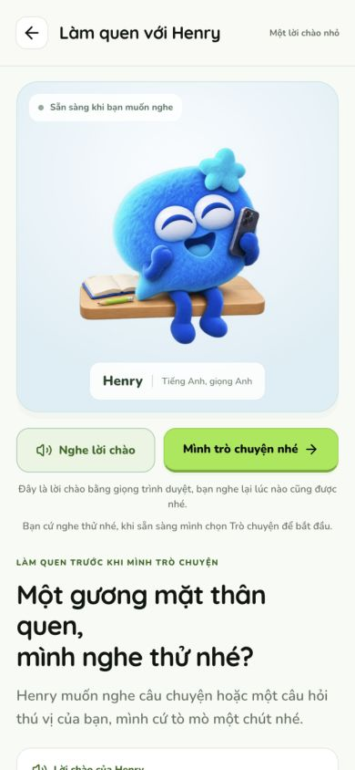

# Mascot tutors, 16 November 2026

The original blue Buddy and Option 5 purple caterpillar now replace the human tutor artwork in conversations, greeting previews, tutor selection, small tutor portraits and transcript bubbles. Each identity sits on a study desktop with a notebook and pencil. The blue Buddy holds its phone with a hand. Option 5 now uses a free armless body and a separate microphone control, as recorded in [the Option 5 follow-up](option5-microphone-qa.md). Tutor names, personalities, accents and speech controls remain selectable.

Two transparent 2172 × 724 sprite sheets contain listening, speaking and laughing illustrations. `TutorAvatar` cycles speaking and laughing expressions while browser speech reports playback, with a brief welcoming smile on arrival; optional movement stops while listening, when playback ends and under reduced-motion preferences. The illustration is not a live call, rigged 3D model or phoneme-level lip sync. The human GLB renderer is no longer imported by the client. The tutor renderer chunk is now about 2 kB before gzip, with illustration assets loaded separately.

Both illustration sources were generated with the built-in Imagegen tool from the existing brand references. Full prompts live in `tools/tutor-mascot-prompts.md` and `tools/option5-mic-prompts.md`; runtime paths, sizes and hashes are in `public/brand/tutor-art-provenance.json`. Original brand images are retained.

## Verification

- TypeScript and Vite production build passed. The existing main-bundle size advisory remains.
- Browser walkthrough covered original-brand Free Talk, its generated mascot portrait, the four tutor selection cards, Henry's greeting and the greeting-to-conversation action. No human tutor images remain in those screens.
- Browser playback reported `speaking` during replay. The artwork changed from speaking to laughing during that playback and returned to its waiting pose afterwards. Microphone listening is prioritized by the component's mode logic; no physical microphone permission or recording was requested for this visual update.
- Reduced motion was emulated: playback still reported speaking, the scene retained its speaking pose, and computed animation was `none`. The emulation was reset.
- The new sprite URL was intentionally blocked to exercise failure handling. The conversation showed the existing brand Buddy, an explanation and a Reload mascot button. Restoring the URL and pressing reload restored the desk scene to ready. Network restrictions and cache overrides were removed after testing.
- Both identities were visually checked at 390 × 844. Responsive checks at 320 × 568, 768 × 1024, 1024 × 768 and 1440 × 900 found no horizontal page overflow or overlap between the mascot scene and caption. Short desktop screens use two columns to keep the desk illustration large.
- The final Option 5 page reported no console errors. Camera behavior, real voice quality and microphone hardware were not changed or newly validated.

