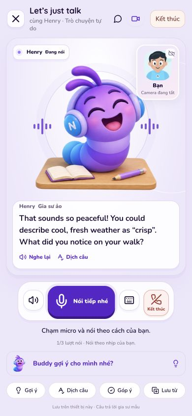

# Option 5 separate microphone, 16 November 2026

Option 5 uses a natural armless caterpillar body with no smartphone or front appendage. A separate microphone pill below the scene shows Nhấn để bắt đầu before a reply, Đang mở mic… while the existing recognition hook is pending, Đang nghe… while listening, and Nói tiếp nhé after a reply. The same button retains the existing start/stop behavior and exposes its listening state through aria-pressed.

The shared artwork and portrait components use the new Option 5 sprite, so conversation scenes, tutor cards, greeting previews and small portraits all show the free torso. The original blue brand still uses its smartphone illustration and icon microphone control. Option 5's greeting copy now describes its headphones rather than a held phone.

Decorative sound bars and a halo appear around Option 5 during speech/listening states. Bars animate during browser speech playback, remain static for listening and stop under reduced motion. They are a visual state indicator, not a measured audio-level meter or pronunciation score.

## Verification

- TypeScript and Vite production build passed, with the existing main-bundle size advisory.
- The new built-in Imagegen edit was visually inspected: all three poses retain the segmented armless anatomy, headphones, study desk, book and pencil, with no phone, hands or held objects. Source PNG dimensions are 2172 × 724 with alpha. The prior sprite is retained; prompts are in `tools/option5-mic-prompts.md` and hashes are in `public/brand/tutor-art-provenance.json`.
- Browser verification used a separate local test origin. A real browser-voice replay showed the speaking/laughing poses and decorative bars. A keyboard reply updated the turn count to 1/3 and the mic label to Nói tiếp nhé. Gallery and greeting preview resolved the new asset, and the greeting copy referred to headphones.
- At 320 × 568, 768 × 1024, 1024 × 768 and 1440 × 900, neither the page nor control dock overflowed horizontally; the label fit its microphone button and captions did not cover the mascot. The initial label was visually checked at 390 × 844.
- Reduced-motion emulation reported `none` for both mascot and bar animation during speaking; the override was reset. The final Option 5 page recorded no console errors.
- The original brand was opened separately: its sprite URL remained `/brand/tutor-desk-sprites.png`, and neither the Option 5 mic label nor its halo was present.
- No physical microphone or camera permission was requested. Pending/listening labels were checked against the existing recognition state bindings, rather than through a hardware recording.

